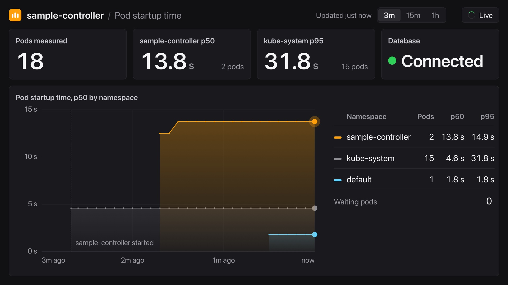

# Example: Measure pod startup time on a container cluster

This example shows you how to use `container cluster` to run a Kubernetes controller and
its database on a local cluster, reach it from your Mac's browser through a LoadBalancer
address, and change what it is allowed to reach with network policies.

The app, sample-app, watches every pod and records how long it takes to start: from
creation to scheduled, and from creation to Ready. It keeps the times in PostgreSQL,
running in the same cluster. One page shows the startup percentiles of every namespace,
over the last 3 minutes, 15 minutes or hour, with the app's own namespace first.



## Prerequisites

Install and start before you run the example:

- Apple `container` release 1.7.0 or later
- [`kubectl`](https://kubernetes.io/docs/tasks/tools/)

Optional:

- [Go](https://go.dev/dl/) and `make`, to build and test on the Mac (see
  [Make targets](#make-targets)). The [container machine](#write-and-test-in-linux) has
  both already.
- [Helm](https://helm.sh/), only to render `cluster/cilium.yaml` again

The example pins your default container network to `192.168.70.0/24`, a change to
`~/.config/container/config.toml` that applies to every container on your Mac. See
[Before you start](#before-you-start).

## Architecture

```
  ┌──────────┐
  │  Browser │   http://192.168.70.254
  └────┬─────┘
       │  Cilium L2 announcement: one node answers ARP for .254
  ┌────┴─────────────────────────────────┐
  │  sample-app Service   LoadBalancer   │   allow-lb admits 8080/TCP
  └────┬─────────────────────────────────┘
       │
  ┌────┴─────────────────────────────────┐
  │  sample-app pod                      │──► Kubernetes API: watch every pod (read-only)
  └────┬─────────────────────────────────┘
       │  5432/TCP                            deny-db / allow-db
  ┌────┴─────────────────────────────────┐
  │  postgres pod                        │
  └──────────────────────────────────────┘
```

The cluster has one control plane and three workers, each in its own VM, with Cilium as
the CNI. Cilium gives the LoadBalancer Service an address on the Mac's default container
network, and it enforces the network policies in `config/`.
The cluster shares the Mac's image store, so an image built with `container build` runs in
the cluster with no registry and no load step.

## Before you start

Run every command on the Mac, from this directory.

### Pin the default network's subnet, once

Add these lines to `~/.config/container/config.toml`.
If the file already has a `[network]` table, add only the `subnet` line to it.

```toml
[network]
subnet = "192.168.70.0/24"
```

To use another /24, change both addresses in `cluster/lb-pool.yaml` to its `.254`.
`container network create` without `--subnet` also uses this subnet, so give other
networks their own `--subnet`.
Check that no VPN, Docker or other hypervisor already uses the subnet:
`netstat -rn | grep 192.168.70` prints nothing.

Restart the container services and check the subnet:

```sh
container system stop
container system start
container network list            # default  192.168.70.0/24
```

[cluster/README.md](cluster/README.md#why-the-subnet-is-pinned) explains why the subnet
must be pinned. To undo the change after you are done, delete the `subnet` line and
restart the container services again.

### Name the cluster

Set the cluster's name, and keep it set in this shell for every command after it:

```sh
export CLUSTER=local-cluster1
```

Creating the cluster makes the cluster's name the current kubeconfig context, so the
`kubectl` commands below talk to it. In another terminal, run
`kubectl config use-context ${CLUSTER:-local-cluster1}` first.

To keep the example out of your main kubeconfig, export `KUBECONFIG` to a separate file
first, and keep it set for every command after it.

## Set up

Follow these steps to create the cluster, and build, deploy and open the app.

### 1. Create the cluster

```sh
container cluster create --name ${CLUSTER:-local-cluster1} --workers 3 --cni ./cluster/cilium.yaml --shared-image-store
```

- `--name ${CLUSTER:-local-cluster1}`: the cluster's name, and so its kubeconfig context.
- `--workers 3`: a control plane and three worker nodes, each in its own VM.
- `--cni`: create applies `cilium.yaml` before the workers join, then waits for every node
  to be `Ready`. Cilium must start during create.
- `--shared-image-store`: the nodes use the Mac's image store. An image built with
  `container build` runs in the cluster with no load step and no registry, as in step 2.
  The example needs it, and it cannot be added to a cluster later.

Creating the cluster takes about 10 minutes. Then give Cilium its LoadBalancer address and
its L2 announcement policy, after Cilium's CRDs exist:

```sh
kubectl wait --for condition=established --timeout=120s \
  crd/ciliumloadbalancerippools.cilium.io crd/ciliuml2announcementpolicies.cilium.io
kubectl apply -f cluster/lb-pool.yaml -f cluster/l2-policy.yaml
kubectl get ippools
kubectl get nodes
```

[cluster/README.md](cluster/README.md) explains each Cilium setting and has a verify list.

> [!WARNING]
> **Do not stop and start the cluster. Delete it and create it again.**
> A restart gives every node a new IP, and the cluster does not recover from that.
> After a Mac restart or `container system stop`, delete the cluster, then create it
> again as in this step:
>
> ```sh
> container cluster delete --name ${CLUSTER:-local-cluster1}
> ```

### 2. Build the image

```sh
container build -t sample-app:dev .
```

The image store is shared into the cluster, so the nodes have `sample-app:dev` as soon as
the build ends.
The Deployment sets `imagePullPolicy: Never`: a missing image fails at once with
`ErrImageNeverPull`, and nothing is pulled from a registry.

The image is built from `Containerfile`. `container build` finds a `Containerfile` in the
context directory as well as a `Dockerfile`, and picks a `Dockerfile` first if both exist.

### 3. Deploy

```sh
kubectl apply -k config/default
kubectl get pods,svc -n sample-controller
```

`config/default` creates the `sample-controller` namespace, Postgres, read-only RBAC for
pods, the app, and `default-deny`.
`default-deny` is a NetworkPolicy that blocks all ingress to the app's pods.
It restricts ingress only, so the app still reaches Postgres.

Wait until both pods are `Running` and the `sample-app` Service has the `EXTERNAL-IP`
`192.168.70.254`:

```text
NAME                              READY   STATUS    RESTARTS   AGE
pod/postgres-<hash>               1/1     Running   0          30s
pod/sample-app-<hash>             1/1     Running   0          30s

NAME                 TYPE           CLUSTER-IP     EXTERNAL-IP      PORT(S)
service/postgres     ClusterIP      10.96.<x>      <none>           5432/TCP
service/sample-app   LoadBalancer   10.96.<x>      192.168.70.254   80:<port>/TCP
```

Cilium LB IPAM gives the Service the pool's one address, and the L2 announcement makes
that address reachable from the Mac.

### 4. Open the LoadBalancer address

```sh
open http://192.168.70.254
```

The page does not load yet. `default-deny` drops the traffic, as it should.

### 5. Allow the load balancer

```sh
kubectl apply -f config/policy/allow-lb.yaml
```

Reload the page. It loads, and the page already shows the startup times of the pods in
the cluster: the controller backfills every running pod when it starts.

`allow-lb` is a `CiliumNetworkPolicy`.
It opens the app's pod port, 8080/TCP, to the two entities that LoadBalancer traffic
arrives as:

- `world`: the pod is on the node that announces the address, and the packet keeps the
  Mac's address.
- `remote-node`: the pod is on another node. The announcing node forwards the packet and
  SNATs it to its own node IP.

It names the pod port, not the Service port 80, because Cilium matches ports after the
service port mapping.
Cilium enforces Kubernetes and Cilium policies together, and allow rules add up, so this is
the only ingress the app's pods take.
It has no egress section, so egress stays open.

## Try it

Scale a workload, and the `default` namespace joins the chart and the table live:

```sh
kubectl apply -f config/samples/hello.yaml
kubectl scale deployment hello --replicas 10
```

`hello` runs the pause image, which starts in a moment.

Block the app from its database, then let it back in:

```sh
kubectl apply -f config/policy/deny-db.yaml      # the page says "Database unreachable"
kubectl scale deployment hello --replicas 15     # pods keep starting; their rows wait
kubectl apply -f config/policy/allow-db.yaml     # the waiting pods fill in
```

`deny-db` is a default-deny for ingress on the Postgres pods.
The app opens a new connection for every database call, with a 2 s timeout, so the page
shows the change within a few seconds.
`allow-db` admits only the app's pods, on 5432. Policies add up, so with both in place the
app gets through and nothing else does.

Edit, build, and roll out. Change the percentile line in `cmd/sample-app/main.go`:

```go
var percentiles = []float64{50, 95, 99}
```

```sh
container build -t sample-app:dev .
kubectl -n sample-controller rollout restart deployment/sample-app
kubectl -n sample-controller rollout status deployment/sample-app --timeout=120s
```

The table gains a p99 column, and the card for the busiest other namespace switches to p99.
The tag stays `sample-app:dev`, so the restarted pod starts from the new build.

## Clean up

```sh
kubectl delete -f config/policy --ignore-not-found
kubectl delete -f config/samples/hello.yaml --ignore-not-found
kubectl delete -k config/default --ignore-not-found
```

This deletes Postgres and its `emptyDir`, so the next run starts with no rows.
The running pods come back, because the controller backfills them at start.
If you changed `cmd/sample-app/main.go`, set the line back to
`var percentiles = []float64{50, 95}` and build the image again.

To start from nothing, delete the cluster:

```sh
container cluster delete --name ${CLUSTER:-local-cluster1}
```

## Write and test in Linux

`container-machine/Containerfile` is a container machine for building and testing in
Linux: Debian with Go, make, git and zsh. Build it and create the container machine once,
on the Mac, from this directory. The container machine is named `dev`, and the prompt
shows it.

```sh
container build -t sample-app-container-machine:dev container-machine
container machine create sample-app-container-machine:dev --name dev
container machine set -n dev cpus=8 memory=16G
container machine stop dev                    # the new size applies at the next boot
```

Then, any time:

```sh
container machine run -n dev                  # a Linux shell, same directory
go test ./...                                 # unit tests; make test adds envtest
go build -o bin/sample-app ./cmd/sample-app
exit
```

## Troubleshooting

| Symptom | Cause and fix |
| --- | --- |
| `kubectl` says `context was not found`, or talks to another cluster. | The kubeconfig's current context is not the example cluster, or the cluster has another name than `CLUSTER` (default `local-cluster1`). Run `kubectl config get-contexts`, then `kubectl config use-context <the example cluster's name>`. |
| `kubectl` says `NotFound` for `sample-app`. | The command is missing `-n sample-controller`; without it `kubectl` looks in `default`. |
| `container cluster create` fails, and the cluster is gone. | Create deletes the cluster when the kube-system pods are not ready in 600 s, usually after a slow or failed image pull. See [cluster/README.md](cluster/README.md#troubleshooting). |
| The Service has no `EXTERNAL-IP`. | The pool is not applied, or the default network is not `192.168.70.0/24`. Run `kubectl get ippools` and `container network list`, then apply the pool again as in [step 1](#1-create-the-cluster). Then see [cluster/README.md](cluster/README.md#troubleshooting). |
| The Service has an `EXTERNAL-IP`, but the page does not load. | Before step 5 this is expected. After step 5, check that `allow-lb` exists (`kubectl get cnp -n sample-controller`), then check the L2 announcement with verify step 5 in [cluster/README.md](cluster/README.md#verify). |
| A pod shows `ErrImageNeverPull`. | The nodes do not have `sample-app:dev`. Either the build failed (run step 2 again), or the cluster was created by hand without `--shared-image-store`, which cannot be added later. Delete the cluster (`container cluster delete --name ${CLUSTER:-local-cluster1}`) and create it again as in [step 1](#1-create-the-cluster). |
| The build fails with `x509: certificate signed by unknown authority`. | The build used a module proxy whose CA the build VM does not trust. Build with the default `GOPROXY` (`https://proxy.golang.org,direct`), with no `--build-arg GOPROXY=...`. |
| The page does not say "Database unreachable" after `deny-db`. | Check the policy with a throwaway client: `kubectl -n sample-controller run dbcheck --rm -i --restart=Never --image=postgres:17.6-alpine -- pg_isready -h postgres -p 5432 -t 2`. With `deny-db` it gets no response. With `allow-db` it still fails, because it is not the app. |
| Nothing else works, and the page must show. | Port-forward around the LoadBalancer: `kubectl -n sample-controller port-forward service/sample-app 8080:80`, then open `http://localhost:8080`. |

## Reference

### How it works

| Piece | What it does |
| --- | --- |
| `internal/controller` | One Pod reconciler, for every namespace. When a pod becomes Ready, it queues one row: UID (the primary key), namespace, name, node, owner workload, creation time, and seconds to scheduled and to Ready. On start it reconciles every existing pod, so pods already running are backfilled. |
| `internal/tracker` | The timing, and the percentiles, interpolated between ranks. The queue keeps rows until Postgres takes them and keeps the last 1000 rows for the page. If the database is unreachable, rows wait and the status says so. When it returns, the queue drains and the missing pods fill in. |
| `internal/web` | One HTTP server: the page, `GET /api/state` (the last 1000 rows, the percentiles overall and per namespace, the app's namespace and start time, the database status), `GET /api/events` (the same state as server-sent events, sent when it changes), and `GET /healthz`. |
| `internal/memstore` | An in-memory store, for the tests. |
| `cmd/sample-app/main.go` | Wires it together. The percentiles the page shows are one line: `var percentiles = []float64{50, 95}`. |

One rule times every pod, in `tracker.Measure`:
- **Created after the controller started:** timed by the controller's own observations,
  from first seen to Ready seen, to the millisecond.
- **Already there when it started:** backfilled from the pod's creation timestamp and its
  Ready condition, to the second.

Every database call opens its own connection, with a 2 s connect timeout. A connection
kept open could outlive a network policy that now blocks the database, and the page would
never say so.

### Images

- `postgres:17.6-alpine` for the database.
- `registry.k8s.io/pause:3.10.1` for `hello`.
  It starts in a moment, and once it is on the nodes, scaling to ten pulls nothing.
- `sample-app:dev` for the app: built locally and seen by the nodes through the shared
  image store, with `imagePullPolicy: Never`.

### Make targets

The `Makefile` builds and tests the app. It does not talk to a cluster: follow the
[Set up](#set-up) steps for that. `make help` lists every target.

| Target | What it does |
| --- | --- |
| `test` | Unit tests and envtest, on macOS and in a Linux container machine. Setting `PG_URL` adds the Postgres integration test. |
| `envtest` | Downloads the envtest API server and etcd for this OS. |
| `build` | Builds `bin/sample-app`. |
| `image` | Builds the image with the container CLI, as in [step 2](#2-build-the-image). Set `IMG` for another tag (default `sample-app:dev`), and `IMAGE_GOPROXY` for another module proxy (default `https://proxy.golang.org,direct`, not the host's `go env GOPROXY`, which the build VM may not reach or trust). |

### Configuration

| Path | What it holds |
| --- | --- |
| `cluster` | The Cilium manifest and its Helm values, the LoadBalancer pool and the L2 announcement policy. [cluster/README.md](cluster/README.md) explains them. |
| `config/default` | The app, Postgres, and the app's `default-deny` policy. |
| `config/postgres` | Postgres: one replica, emptyDir storage, and a password from a kustomize `secretGenerator`. |
| `config/manager` | The app's Deployment, its LoadBalancer Service, and `default-deny` (no ingress to the app's pods). |
| `config/rbac` | Read-only access to pods. |
| `config/samples/hello.yaml` | The workload to scale. |
| `config/policy` | `allow-lb` (a `CiliumNetworkPolicy`: the app's port 8080 from `world` and `remote-node`), `deny-db` and `allow-db`. |
| `Containerfile` | The app's image. `container-machine/Containerfile` is the container machine's image. |

`internal/controller/config_gate_test.go` decodes every Kubernetes manifest into
`k8s.io/api` types, and `allow-lb` into a strict subset of the Cilium type.
It checks that each Deployment's selector matches its pods, that each Service selects the
right pods and ports, that `deny-db` and `allow-db` select Postgres and admit only the app
on 5432, that `default-deny` selects the app, and that `allow-lb` selects the app and
opens only 8080/TCP from `world` and `remote-node`, with no egress section.
